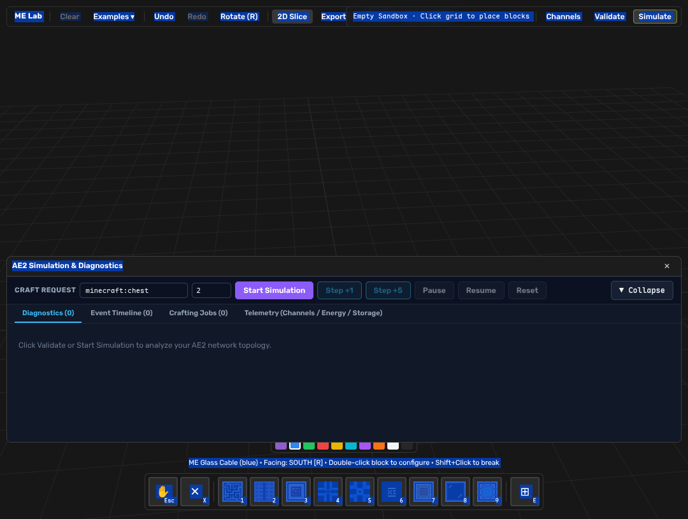
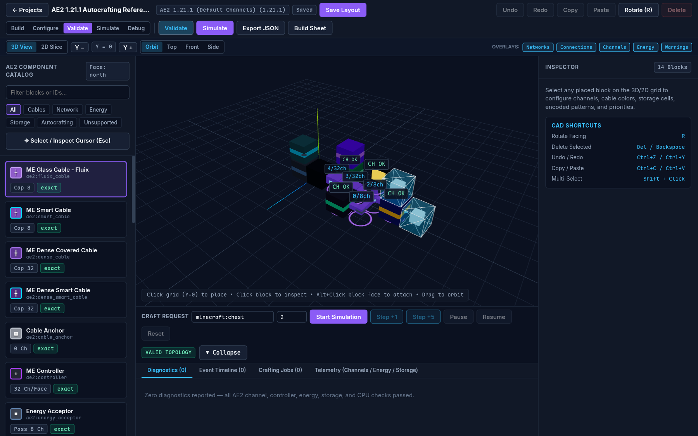
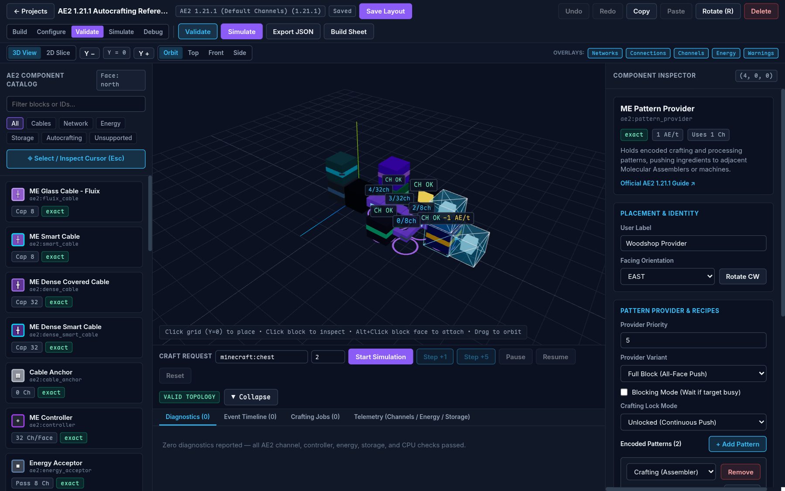
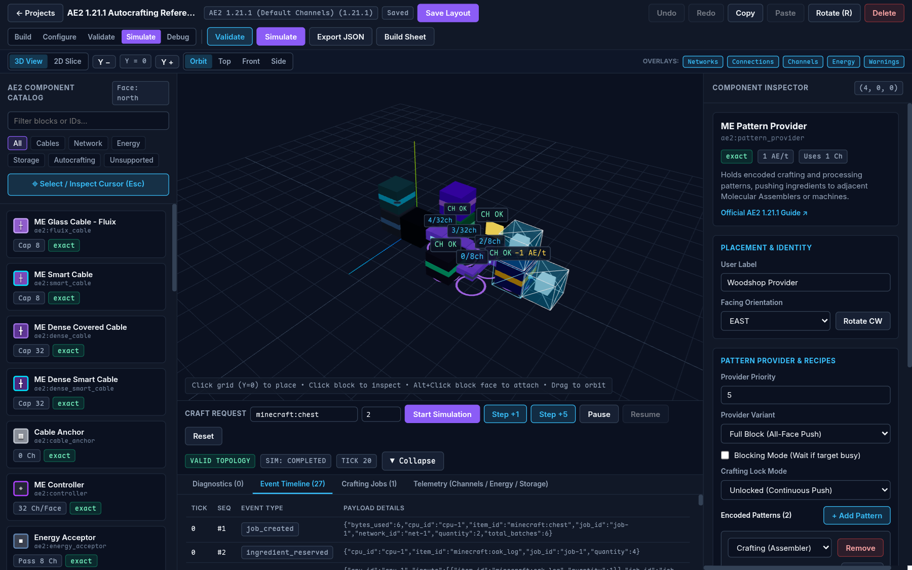
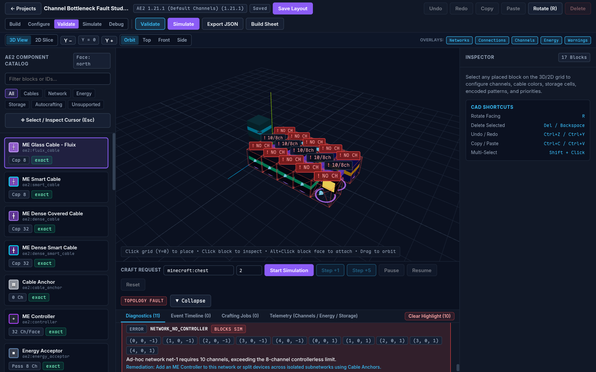
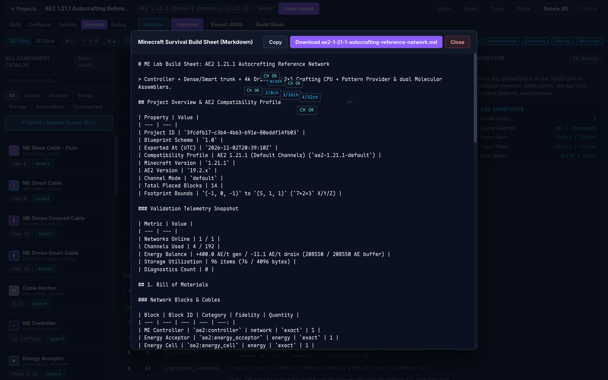
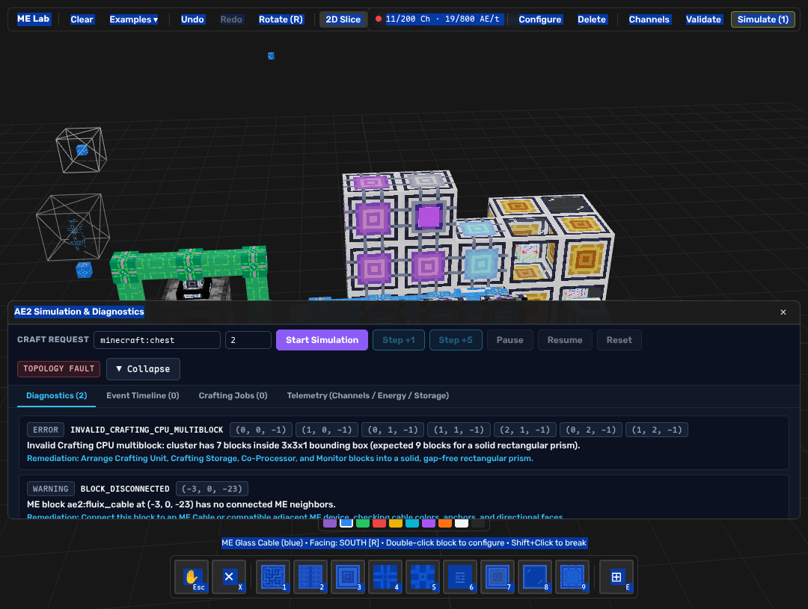
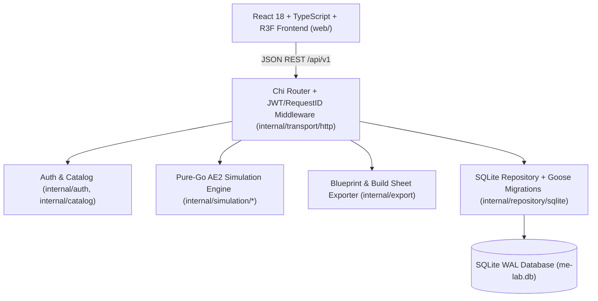
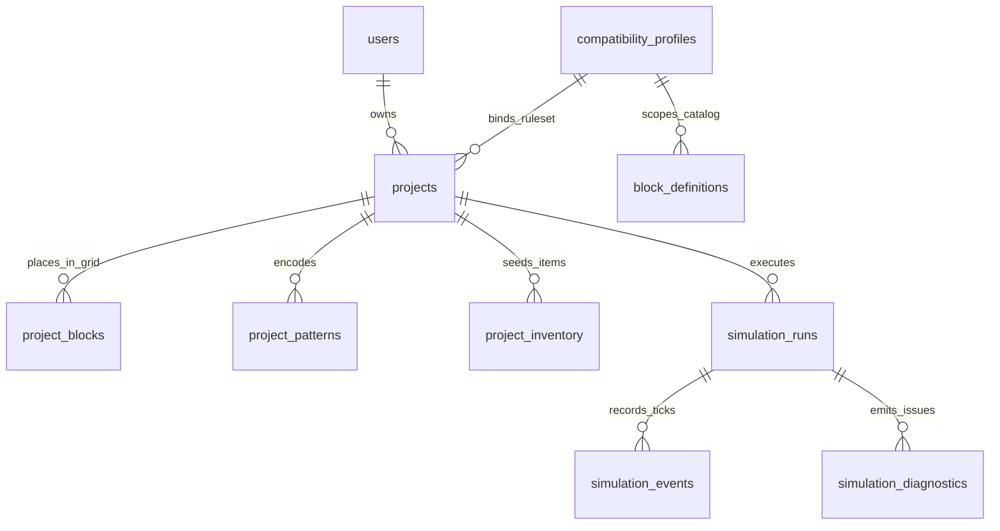
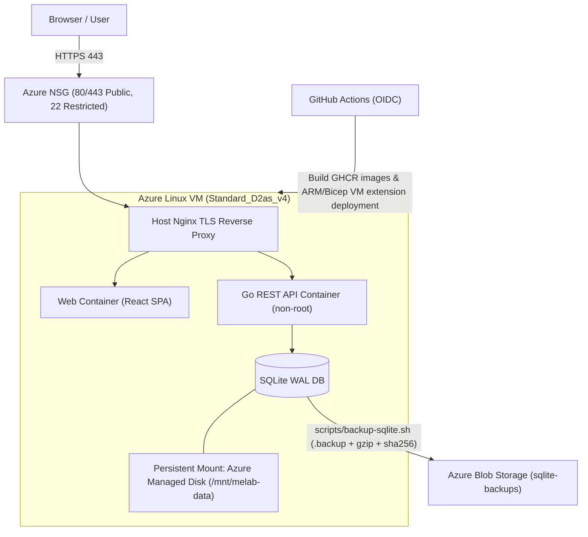

# ME Lab — AE2 Network Designer & Live Runtime

**ME Lab** is a browser-based 3D/2D CAD editor and deterministic runtime for **Applied Energistics 2 (AE2)** installations (targeting **Minecraft 1.21.1 / AE2 19.2.x**). Design a network, inspect live channel and energy state, interact with inventories and machines, and export a Minecraft-ready build sheet before placing a single block in-game.

---

## Screenshots

### 1. Immediate Empty 3D Sandbox


### 2. 3D Voxel CAD Workspace & Live Smart-Cable Channel Overlays


### 3. Context-Sensitive Block Inspector & Pattern Encoder


### 4. Deterministic Tick-Stepped Autocrafting Simulation & Event Timeline


### 5. Actionable Diagnostics & 3D Crimson Fault Highlighting


### 6. Human-Readable Build Sheet & Bill of Materials Export


### 7. Guide Showcase Preset with Live Diagnostics


---

## Core Capabilities

- **Authentication & Multi-Tenant Project Isolation:** Argon2id (`m=65536, t=3, p=2`) password hashing, HS256 JWT authentication, and strict server-side project ownership checks across all `/api/v1` endpoints.
- **3D + 2D Voxel CAD Workspace:** Interactive React Three Fiber 3D scene (orbit, top, front, side camera presets, WASD camera navigation with Shift sprint, direct hand-tool block dragging on the horizontal voxel plane, procedural non-proprietary meshes, dynamic 3D cable connector arms) paired with a synchronized 2D Y-layer slice editor, Undo/Redo stack, Copy/Paste/Duplicate, rotation (`R`), multi-select (`Shift+Click`), and truthful API-reconciled save status.
- **Data-Driven AE2 1.21.1 Catalog & Profiles:** Embedded compatibility profiles (`ae2-1.21.1-default`, `ae2-1.21.1-x2`, `ae2-1.21.1-infinite`) and the catalog's block definitions with explicit fidelity labels (`exact`, `approximated`, `unsupported`) including textured Minecraft furnaces, blast furnaces, barrels, chests, and hoppers, with direct links to the [official AE2 1.21.1 guide](https://guide.appliedenergistics.org/1.21.1/index).
- **Authoritative Go Simulation Engine (`internal/simulation/`):** Pure-Go domain engine completely decoupled from HTTP, SQLite, and frontend code:
  - **World & Connectivity (`world`):** Face-level port rules, colored vs. universal `fluix` cable isolation, Cable Anchors, directional Pattern Provider push-face network isolation, and unsupported block detection.
  - **Topology & Multiblocks (`network`):** Deterministic connected-component discovery, ME Controller multiblock validation (single connected cluster per network, `<= 7x7x7` span, `<= 1` opposite-neighbor axis per block), and Crafting CPU solid rectangular-prism validation.
  - **3-Tier AE2 Channel Routing (`channels`):** Models ad-hoc networks (`8` channels network-wide in default mode, smart cables reporting network-wide usage) separately from controller-based networks (`Machine -> Normal Cable [8] -> Dense Cable [32] -> Controller Face [32]` shortest-path routing with bottleneck identification).
  - **Energy Engine (`energy`):** Per-node `25 AE` buffers, `8,000 AE` Controller buffer (`6 AE/t` drain), `200k` / `1.6M` / Creative Energy Cells, `2 FE = 1 AE` Energy Acceptor conversion, `1/128 AE/t` channel traversal drain, active `20 AE/t` Molecular Assembler load, and tick-accurate brownout/recovery.
  - **Storage Engine (`storage`):** Exact AE2 cell byte & type capacity math (`63` max types, tier-specific `bytes_per_type` from `8 B` on `1k` to `2048 B` on `256k`, `ceil(qty / 8)` item bytes), whitelist/Inverter Card partitions, and drive `priority` ordering.
  - **Live ME terminals:** the ME Crafting Terminal reads network storage and craftable Pattern Provider outputs and queues requests into the running Crafting CPU; the ME Pattern Encoding Terminal persists crafting/processing encodings and installs them into providers without manual simulation controls. See the [version-matched terminal contract](docs/architecture/ae2-compatibility-1.21.1.md#210-crafting-terminal-and-pattern-encoding-terminal).
- **Blueprint & Build Sheet Export:** Deterministic JSON blueprint (`/export/json`) and Markdown build sheet (`/export/build-sheet`) with Bill of Materials, Y-layer placement tables, cell partitions, encoded patterns, and pre-flight checklist.

---

## Compatibility Fidelity & Honest Non-Goals

Every catalog entry and simulated mechanic carries an explicit fidelity label (`docs/architecture/ae2-compatibility-1.21.1.md`):

| Mechanic / Block Family | Fidelity | Notes |
| --- | --- | --- |
| Standard, Smart, Dense & Colored Cables, Cable Anchors | `exact` | 8 / 32 channels (scaled by `default`, `x2`, `infinite`), color isolation, face anchors |
| Ad-Hoc vs. ME Controller Networks & Multiblock Rules | `exact` | 8-device ad-hoc cap; 7×7×7 span, single cluster, `<= 1` opposite-neighbor axis |
| 3-Stage Controller Channel Routing | `exact` | Tiered shortest-path (`Device -> Normal -> Dense -> Controller Face`) exposing exact `[]Coord3D` routes |
| ME Drive & Item Storage Cells (`1k`–`256k`) | `exact` | 63 types, exact `bytes_per_type`, 8 items/byte, priority, whitelist & Inverter partitions |
| Crafting CPU, Pattern Provider & Molecular Assembler | `exact` | Solid prism CPU, `1 + co_processors` batch rate, directional push face, Blocking & Lock modes |
| `melab:external_machine`, Storage/Import/Export Buses | `approximated` | Deterministic runtime processing and powered item-transfer model; exact external mod inventories are intentionally not claimed |
| P2P Tunnels, Quantum Ring | `unsupported` | Placed blocks emit explicit `UNSUPPORTED_MECHANIC` diagnostics rather than faking parity |

**Non-Goals:** ME Lab does not launch or host Minecraft, redistribute proprietary Minecraft/AE2 textures, attach to a live game server, or claim full modpack addon parity beyond tested profile rules.

---

## Architecture & Visual Documentation

Editable Mermaid diagram sources live in [`docs/diagrams/`](docs/diagrams/):

1. [`docs/diagrams/01-system-context.mmd`](docs/diagrams/01-system-context.mmd) — System context across player, browser SPA, Azure VM, GitHub Actions OIDC CI/CD, Azure Blob backups, and AE2 1.21.1 reference docs.
2. [`docs/diagrams/02-component-architecture.mmd`](docs/diagrams/02-component-architecture.mmd) — Component boundaries isolating the pure-Go simulation engine from Chi HTTP handlers and SQLite persistence.
3. [`docs/diagrams/03-deployment.mmd`](docs/diagrams/03-deployment.mmd) — End-to-end Azure VM deployment topology with Nginx TLS termination, Docker Compose, Managed Disk `/mnt/melab-data`, and Blob Storage backups.
4. [`docs/diagrams/04-er-diagram.mmd`](docs/diagrams/04-er-diagram.mmd) — Relational SQLite schema across all 10 tables.
5. [`docs/diagrams/05-simulation-sequence.mmd`](docs/diagrams/05-simulation-sequence.mmd) — Sequence flow for validation and stateful tick-stepped autocrafting runs.
6. [`docs/diagrams/06-sample-network-topology.mmd`](docs/diagrams/06-sample-network-topology.mmd) — Sample AE2 network illustrating controller faces, dense/smart trunks, storage, CPU multiblock, and crafting loop.

### Component Architecture

The React + React Three Fiber frontend communicates exclusively through the versioned Go REST API (`/api/v1`), which delegates all topological, channel, energy, storage, and crafting rules to the pure-Go `internal/simulation` packages and persists state in WAL-mode SQLite:



### Relational Database Schema (SQLite)

Projects, placed blocks, patterns, inventories, simulation runs, tick events, and diagnostics are stored relationally with `PRAGMA foreign_keys = ON`, `PRAGMA journal_mode = WAL`, and `PRAGMA busy_timeout = 5000`:



### Azure Production Deployment Topology

In production on Microsoft Azure (`deployments/azure/main.bicep`), Nginx terminates HTTPS (`443`) on an Ubuntu 24.04 LTS VM, reverse-proxies to unprivileged Docker Compose containers (`api` and `web`), mounts SQLite onto an Azure Managed SSD Disk (`/mnt/melab-data`), and ships verified online `.backup` snapshots to Azure Blob Storage via System-Assigned Managed Identity:



---

## Local Setup & Development

### Option A: NixOS / Nix Flakes + `devenv` (Recommended on NixOS)

This repository ships both [`devenv.nix`](devenv.nix) (`devenv.yaml` + `.envrc`) and [`flake.nix`](flake.nix) configured to work out of the box on NixOS without requiring `trusted-users`:

```bash
# Automatic activation with direnv + devenv:
direnv allow .

# Or enter the devenv shell directly:
devenv shell

# Or enter the standard Nix Flake devShell:
nix develop

# Install frontend dependencies once:
cd web && npm ci && cd ..

# Start both Go API (:8080) and Vite frontend (:5173):
devenv up
# (Or in separate terminals: `make dev` and `make dev-frontend`)
```

### Option B: Standard Go + Node.js Toolchain

Prerequisites: **Go 1.26+**, **Node.js 22+**, **SQLite 3** (optional, for backup scripts).

```bash
cp .env.example .env
go mod download
cd web && npm ci && cd ..

# Terminal 1 — Start Go API (auto-applies Goose migrations & seeds AE2 catalog)
make dev

# Terminal 2 — Start React + R3F frontend on http://localhost:5173
make dev-frontend
```

### Option C: Docker Compose

```bash
cp .env.example .env
docker compose -f compose.yaml up --build -d
# Web UI + API proxy: http://localhost:8081
# Direct Go API:      http://localhost:8080/health
```

---

## API Documentation (OpenAPI 3.1)

- **Interactive Swagger UI:** `http://localhost:8080/docs` (when API is running)
- **Live OpenAPI 3.1 JSON:** `http://localhost:8080/openapi.json`
- **Static Committed Spec:** [`docs/api/openapi.json`](docs/api/openapi.json)

---

## Automated Tests & Quality Gates

```bash
# Run Go vet + staticcheck
make lint

# Run all 15 Go unit & API integration test packages with race detector
make test

# Run ESLint + TypeScript strict type-check on frontend
make lint-frontend

# Run Vitest + React Testing Library suite
make test-frontend

# Verify online WAL-safe SQLite backup, SHA-256 tamper rejection, and atomic restore
./scripts/test-backup-restore.sh
```

---

## Azure Deployment, Backups & Cost Control

Full Bicep infrastructure-as-code, cloud-init, production Compose, Nginx TLS configuration, and backup/restore runbooks are documented in [`docs/operations/azure-deployment-and-backups.md`](docs/operations/azure-deployment-and-backups.md).

- **GitHub Actions ARM configuration:** The workflow runs on every push. Configure repository/environment variables `AZURE_RESOURCE_GROUP` (optional; defaults to `rg-melab-prod`), `AZURE_LOCATION`, `AZURE_VM_SIZE`, `AZURE_ADMIN_USERNAME`, `AZURE_SSH_ALLOWED_CIDR`, `AZURE_DNS_LABEL_PREFIX`, and optional `PUBLIC_BASE_URL`; configure secrets `AZURE_CLIENT_ID`, `AZURE_TENANT_ID`, `AZURE_SUBSCRIPTION_ID`, `AZURE_SSH_PUBLIC_KEY`, `AZURE_JWT_SECRET`, and a read-only `GHCR_PULL_TOKEN`. It deploys `deployments/azure/subscription.bicep` through `azure/arm-deploy@v2`, which creates the Resource Group when absent and invokes the application Bicep.
- **Provisioned Resources & Estimated Student Cost (`brazilsouth`):**
  - `Standard_D2as_v4` Linux VM: 2 vCPU / 8 GiB; price varies by Azure for Students region and availability.
  - 32 GiB `StandardSSD_LRS` Managed Data Disk (`/mnt/melab-data`): ~$2.40/month.
  - Standard Static Public IPv4 + `Standard_LRS` Blob Storage (`sqlite-backups`): ~$3.80/month combined.
- **Stopping / Deallocating Resources When Not Being Evaluated:**
  ```bash
  # Stop compute billing while preserving the persistent SQLite Managed Disk and Blob backups:
  az vm deallocate --resource-group rg-melab-prod --name vm-melab-prod

  # Restart before demonstration/evaluation:
  az vm start --resource-group rg-melab-prod --name vm-melab-prod
  ```

---

## License

Released under the [MIT License](LICENSE). Applied Energistics 2 and Minecraft are trademarks/creations of their respective authors; ME Lab uses original procedural 3D/2D geometry and contains zero redistributed game assets.
